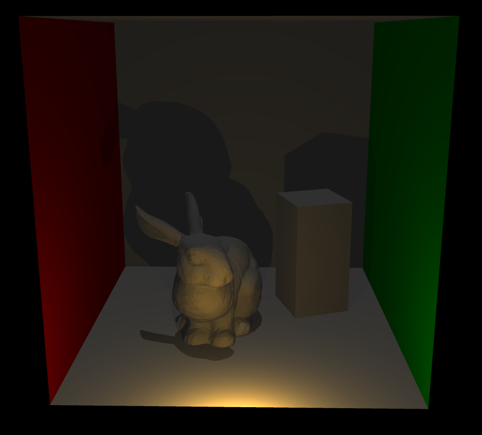

# Whitted raytracer

A real-time, Whitted-style raytracer built from scratch in **C++** and **CUDA**, featuring OpenGL interop and custom BVH acceleration. Currently in active development, with an upcoming integration for an SPH fluid simulation module.


## Capabilities

A quick overview of the raytracer's capabilities. The links lead to specific sections of code for the codebase to be easier to browse.

### Geometry & Acceleration
* **Primitives:** Pinhole camera ray generation supporting arbitrary triangle meshes and analytical spheres (see `Object` in [raytracer.cuh](include/raytracer.cuh#L20-L65) and `SphereMesh` / `TriangleMesh` in [bvh.cuh](include/bvh.cuh#L43-L94)).
* **BVH Acceleration:** Per-mesh Bottom-Level Acceleration Structures (BLAS) using Bounding Volume Hierarchy (BVH) with Axis-Aligned Bounding Boxes (AABB), adapted from Jacco Bikker's [BVH guide](https://jacco.ompf2.com/2022/04/13/how-to-build-a-bvh-part-1-basics/).

### Lighting & Shading
* **Blinn-Phong & Recursive Bounces:** Supports point and directional lights, hard shadow rays, and recursive specular reflections (see `shade()` in [raytracer.cu](src/raytracer.cu#L27-L110)).

### Architecture & Performance
* **CUDA + OpenGL Pipeline:** Ray generation, BVH traversal, and shading run entirely in parallel on the GPU ([kernel wrapper](src/raytracer.cu#L463-L509)), writing to an OpenGL-backed framebuffer while C++ manages scene loading, window interaction and scene display.
* **Performance:** Achieves **~40 FPS** at **1080p** with **9x SSAA** on the scene above (~5,000 primitives) on an NVIDIA RTX 5060 Laptop GPU.

## Running on your machine

### Prerequisites
* **CMake** $\ge$ 3.20
* **NVIDIA GPU & CUDA Toolkit** (configured for CUDA 13.1 at `/usr/local/cuda-13.1/bin/nvcc` by default)
* **C++17-compatible compiler** (`g++` or `clang++`)
* **GLM**

### Instructions

Clone the repository and run the following commands **from the root of the project**:

```bash
rm build -rf && cmake -S . -B build -DCMAKE_CUDA_HOST_COMPILER=path/to/g++ -Dglm_DIR=path/to/glm -DCMAKE_CUDA_FLAGS="-I$HOME/include" -DCMAKE_CXX_FLAGS="-I$HOME/include"
cmake --build build --target finalProj && ./finalProj
```

## Upcoming features

- [ ] Refraction and Fresnel
- [ ] Animation support
- [ ] SPH integration and rendering with implicit surfaces
- [ ] Top-Level Acceleration Structures (TLAS)
- [ ] BVH algorithm refinement
